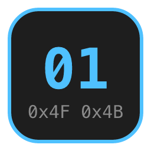
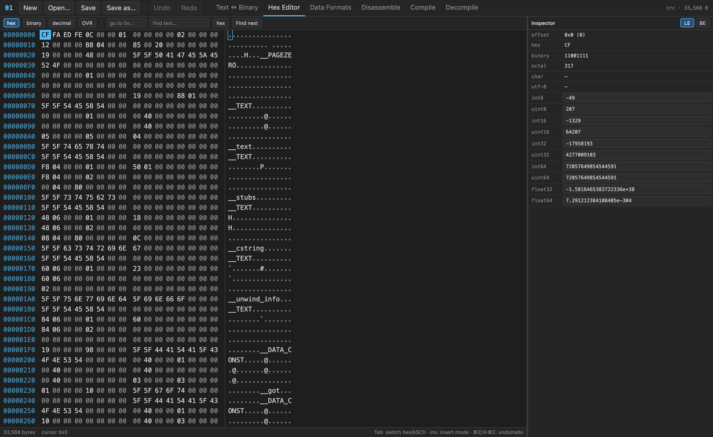
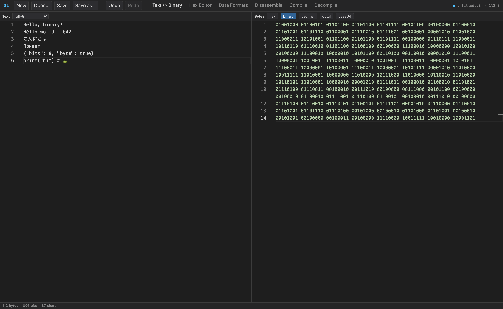
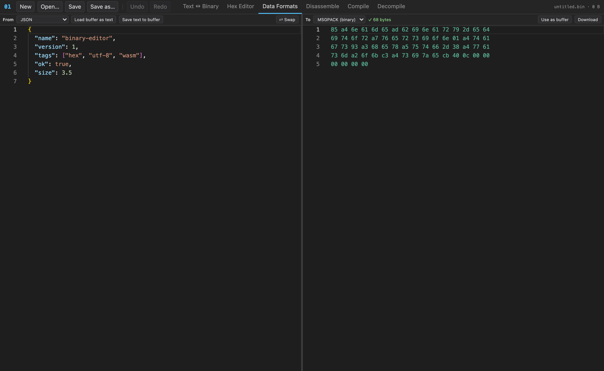
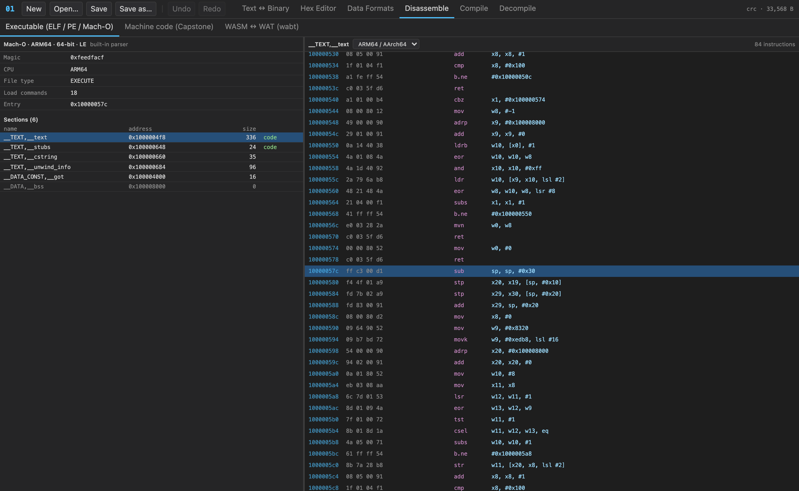
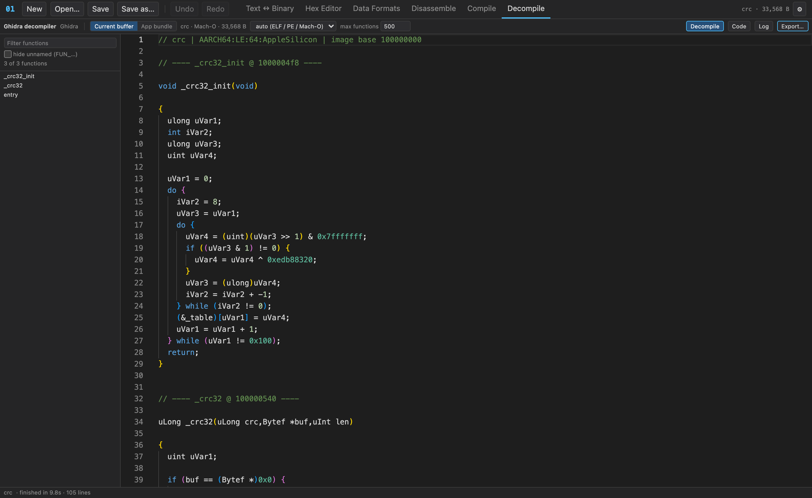

<div align="center">



# Binary Editor

**Convert data, scripts and source code to binary — and back.**

A fast desktop toolkit for working with bytes: live text ↔ binary encoding, a full hex editor,
data-format conversion, disassembly, compilation and Ghidra-powered decompilation in one window.

[](../../releases/latest)


[](LICENSE)

<br />



</div>

---

## Contents

- [Features](#features)
- [Screenshots](#screenshots)
- [Download & install](#download--install)
- [Optional tools](#optional-tools)
- [Build from source](#build-from-source)
- [Testing](#testing)
- [Project structure](#project-structure)
- [Security model](#security-model)
- [License](#license)

## Features

| | Tab | What it does | Powered by |
|---|---|---|---|
| 🔤 | **Text ↔ Binary** | Live, two-way text ↔ bytes in hex, binary, decimal, octal or base64 · 7 text encodings | `TextEncoder`, iconv-lite |
| 🧮 | **Hex Editor** | Virtualized hex / binary / decimal grid for large files · insert & overwrite · undo/redo · find · go-to · byte inspector (int8–int64, float32/64, LE/BE) | @tanstack/react-virtual |
| 🔁 | **Data Formats** | JSON ↔ YAML ↔ CSV ↔ XML ↔ MessagePack ↔ CBOR | yaml, papaparse, fast-xml-parser, @msgpack/msgpack, cbor-x |
| 🧩 | **Disassemble** | ELF / PE / Mach-O headers, sections and symbols · machine code → assembly (x86 16/32/64, ARM, Thumb, ARM64, MIPS, PowerPC, SPARC) · WAT ↔ WASM | goblin, Capstone, wabt |
| ⚙️ | **Compile** | C / C++ / Rust → assembly or object file for many targets · Python → bytecode / `.pyc` | clang, rustc, Python `dis` + `marshal` |
| 🔍 | **Decompile** | Binary or macOS app bundle → C-like code · bundle overview (executables, frameworks, resources, `Info.plist`, detected tech) · per-architecture slices · searchable function list · export to `.c` | Ghidra headless |

**Also:** drag-and-drop any file · recent files · every edit is undoable · keyboard shortcuts (`⌘/Ctrl+O`, `⌘/Ctrl+S`, `⇧⌘/Ctrl+Shift+S`) · runs in the browser too (without Compile / Decompile).

## Screenshots

<table>
  <tr>
    <td width="50%"><p align="center"><b>Text ↔ Binary</b> — UTF-8 text and its bits, edited live from either side</p></td>
    <td width="50%"><p align="center"><b>Data Formats</b> — JSON encoded to MessagePack</p></td>
  </tr>
  <tr>
    <td width="50%"><p align="center"><b>Disassemble</b> — Mach-O sections and ARM64 machine code</p></td>
    <td width="50%"><p align="center"><b>Decompile</b> — the same binary back to C with Ghidra</p></td>
  </tr>
</table>

## Download & install

Grab the installer for your platform from the **[latest release](../../releases/latest)**:

| Platform | File | Notes |
|---|---|---|
| **macOS** 11+ (Apple Silicon & Intel) | `Binary Editor_<version>_universal.dmg` | Open the `.dmg` and drag **Binary Editor** to **Applications** |
| **Windows** 10 / 11 (64-bit) | `Binary Editor_<version>_x64-setup.exe` | Per-user install, no admin rights needed |
| **Linux** | `.AppImage` or `.deb` | `chmod +x` the AppImage and run it |

<details>
<summary><b>macOS says the app “cannot be opened” or is from an “unidentified developer”</b></summary>

<br />

Release builds are not yet notarized by Apple, so Gatekeeper asks for confirmation the first time:

1. Try to open **Binary Editor** once, then click **Done**.
2. Open **System Settings → Privacy & Security**, scroll down and click **Open Anyway**.

Or, from Terminal:

```bash
xattr -dr com.apple.quarantine "/Applications/Binary Editor.app"
```

</details>

<details>
<summary><b>Windows shows “Windows protected your PC” (SmartScreen)</b></summary>

<br />

The installer is not code-signed yet. Click **More info → Run anyway**.
If WebView2 is missing (rare on Windows 10/11), the installer downloads it automatically.

</details>

## Optional tools

The Text, Hex, Formats and Disassemble tabs work out of the box. **Compile** and **Decompile** call
tools that you install separately. Binary Editor finds them on your `PATH` (and in the usual Homebrew
locations), or you can point to them in **⚙ Settings**.

| Feature | Tool | Install (macOS) |
|---|---|---|
| C / C++ → assembly | clang | `xcode-select --install` |
| Rust → assembly | rustc | [rustup.rs](https://rustup.rs) |
| Python → bytecode | Python 3 | `brew install python` |
| Decompile | Ghidra + JDK 21+ | `brew install ghidra` |

## Build from source

**Prerequisites:** [Node.js](https://nodejs.org) 20+, [Rust](https://rustup.rs) (stable), and the
[Tauri system dependencies](https://tauri.app/start/prerequisites/) for your OS.

```bash
git clone https://github.com/OCode3546/B-Editor.git
cd B-Editor
npm install

npm run dev            # browser version at http://localhost:5173 (no Compile / Decompile)
npm run desktop        # desktop app with hot reload
npm run desktop:build  # installers for the current OS
```

Installers are written to `src-tauri/target/<target>/release/bundle/`.

**Universal macOS build** (Apple Silicon + Intel in one app):

```bash
rustup target add aarch64-apple-darwin x86_64-apple-darwin
npx tauri build --target universal-apple-darwin
```

**Windows installer from macOS / Linux** (experimental cross-compile, NSIS only):

```bash
brew install nsis llvm lld
rustup target add x86_64-pc-windows-msvc
cargo install --locked cargo-xwin
PATH="/opt/homebrew/opt/llvm/bin:$PATH" npx tauri build --runner cargo-xwin --target x86_64-pc-windows-msvc
```

> [!TIP]
> If Rust came from Homebrew's `rustup`, add it to your `PATH`:
> `echo 'export PATH="/opt/homebrew/opt/rustup/bin:$PATH"' >> ~/.zshrc`

### Releases

CI ([`.github/workflows/build.yml`](.github/workflows/build.yml)) runs every test suite on each push and
pull request, then builds installers for macOS (universal), Windows and Linux. Pushing a `v*` tag
creates a **draft GitHub release** with all installers attached:

```bash
git tag v0.1.0
git push origin v0.1.0
```

## Testing

```bash
npm test               # Vitest unit tests + fast-check round-trip property tests
npm run test:rust      # Rust tests (add `-- --include-ignored` to include the Ghidra test)
npm run test:e2e       # Playwright UI tests against the dev server
npm run test:e2e:csp   # Playwright against the production build with the desktop CSP
npm run test:all       # everything
```

Every encoder is checked with property tests of the form `decode(encode(x)) === x`.

## Project structure

```
src/
├── components/      one view per tab (EncodeView, HexView, FormatsView, DisasmView, CompileView, DecompileView, …)
├── lib/             encoding, inspector, data formats, executable parser, Capstone / wabt wrappers (+ tests)
├── platform.ts      Tauri IPC bridge (raw byte payloads, no JSON arrays)
└── store.ts         shared document buffer — every edit is an undoable splice
src-tauri/
├── src/             files.rs · settings.rs · exe.rs (goblin) · bundle.rs (app bundles) · tools.rs (clang / rustc / python / ghidra)
└── scripts/         DecompileAll.java (Ghidra post-script)
e2e/                 Playwright specs
docs/screenshots/    images used in this README
```

## Security model

Binary Editor **never executes the files you open**. Binaries are only parsed, and passed as input
files to clang, rustc, Python and Ghidra. Python source goes through `compile()` and is never run.
The desktop app ships with a strict Content-Security-Policy.

## License

Released under the [MIT License](LICENSE).

---

<div align="center">
<sub>Built with <a href="https://tauri.app">Tauri</a>, <a href="https://react.dev">React</a> and <a href="https://www.rust-lang.org">Rust</a>.</sub>
</div>
